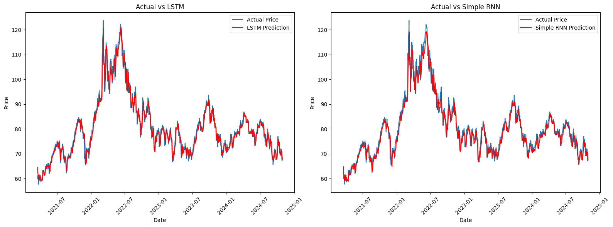

<h1 align="center">
  Oil Price Prediction Using LSTM & Simple RNN
</h1>

<p align="center">
  
</p>

<p align="center">
  <b>Deep Learning Time-Series Forecasting Project</b><br>
  Developed during my internship at <b>Aramco</b>
</p>


## Project Overview

This project focuses on predicting oil prices using deep learning models for time-series forecasting.  
The main goal is to compare the performance of **LSTM** and **Simple RNN** in forecasting future oil closing prices.

---

## Dataset

| Item | Description |
|---|---|
| Source | Kaggle |
| Type | Open-source historical oil price dataset |
| Target Column | Close Price |
| Task | Time-Series Forecasting |

---

## Models Used

| Model | Description | Strength |
|---|---|---|
| LSTM | Learns long-term patterns using memory gates | Better for long sequences |
| Simple RNN | Processes sequential data step by step | Simple baseline model |

---

## Methodology

| Step | Description |
|---|---|
| 1 | Loaded the historical oil price dataset |
| 2 | Converted the Date column to datetime format |
| 3 | Sorted the data in ascending chronological order |
| 4 | Selected the Close column for forecasting |
| 5 | Scaled values using MinMaxScaler |
| 6 | Created time-series sequences |
| 7 | Split data into training, validation, and testing sets |
| 8 | Trained LSTM and Simple RNN models |
| 9 | Evaluated models using regression metrics |
| 10 | Visualized Actual vs Predicted results |

---

## Training Setup

| Parameter | Value |
|---|---|
| Optimizer | Adam |
| Loss Function | Mean Squared Error |
| Batch Size | 32 |
| Epochs | Up to 50 |
| Regularization | Early Stopping |

---

## Evaluation Metrics

| Metric | Purpose |
|---|---|
| MAE | Measures average absolute prediction error |
| RMSE | Penalizes large prediction errors |
| R² Score | Measures how well the model explains price variation |
| Loss Curves | Tracks training and validation behavior |
| Actual vs Predicted | Visual comparison of forecasting performance |

---

## Key Finding

Test-period results of the Google Colab run saved in the notebook (912 trading days, 18 Mar 2021 – 30 Oct 2024, USD per barrel):

| Model | MAE | RMSE | R² |
|---|---:|---:|---:|
| LSTM | 1.7431 | 2.3079 | 0.9634 |
| Simple RNN | 1.8538 | 2.4342 | 0.9593 |
| Persistence baseline (next close = latest close) | 1.5011 | 2.0710 | 0.9705 |

In this run the **LSTM outperformed the Simple RNN** on every metric: about 5% lower RMSE and 6% lower MAE, a difference of roughly $0.11–0.13 per barrel. The margin is small and comes from one training run, so it does not show that LSTM is always the better choice. The LSTM's gated memory, which helps it retain information over longer periods, is a plausible reason for its edge.

Neither model beats the naive persistence baseline on one-step-ahead error: the LSTM's RMSE is about 11% higher and the Simple RNN's about 18% higher. Day-to-day oil prices behave close to a random walk, which makes "same as yesterday" hard to beat. The high R² values mainly reflect that tomorrow's price is close to today's.

---

## RNN Challenges

| Challenge | Explanation |
|---|---|
| Vanishing Gradient | The gradient becomes too small, so the model forgets earlier information |
| Exploding Gradient | The gradient becomes too large, making training unstable |

LSTM helps reduce these issues using gates that control what information should be remembered, updated, or forgotten.

---

## Technologies Used

| Category | Tools |
|---|---|
| Programming | Python |
| Data Handling | Pandas, NumPy |
| Visualization | Matplotlib |
| Preprocessing | Scikit-learn |
| Deep Learning | TensorFlow, Keras |
| Environment | Jupyter Notebook, Google Colab |

---

## Repository Contents

| File / Folder | Description |
|---|---|
| `Oil_Price_Prediction_LSTM_RNN_Comparison.ipynb` | Main notebook for data preprocessing, model training, evaluation, and comparison, with the outputs of the Google Colab run used by the dashboard |
| `Final Report` | Final project report documenting the methodology and results. It documents an earlier training run, so its metrics (for example Simple RNN RMSE 4.3323) differ from the current notebook. |
| `README.md` | Project documentation |
| `requirements.txt` | Required Python libraries |
| `data/` | Dataset-related files |
| `results/` | Model performance visuals and prediction plots |
| `results/lstm_rnn_comparison.png` | Actual vs predicted comparison for LSTM and Simple RNN (from the current notebook run) |

---

## Interactive Dashboard (Streamlit)

An English-language dashboard with four pages:

| Page | What it shows |
|---|---|
| Overview | Dataset coverage, price history with the train / validation / test periods shaded, and a performance summary |
| Historical evaluation | Saved test-period predictions vs actual prices, MAE / RMSE / R² for the full test period or a selected window, a persistence baseline, and CSV export. Filters only change the view. |
| Interactive forecast | Runs the trained LSTM or Simple RNN on the latest 60 observations to forecast the next observation's close, with CSV export |
| About | Project goal, data, models, workflow, settings, and limitations |

### Run it

Use Python 3.12 (tested) or 3.13. TensorFlow has no Python 3.14 release.

```bash
python -m venv .venv
# Windows: .venv\Scripts\activate    macOS/Linux: source .venv/bin/activate
pip install -r requirements.txt

# Optional: check that the app's inference matches the notebook's code path
python scripts/verify_inference.py

streamlit run app.py
```

The repository includes everything the app reads: the dataset (`data/Crude_Oil_Data.csv`) and the verified models, scaler, and saved results in `artifacts/`. The app never trains a model, refits the scaler, or runs the import script. If a file is missing, the affected page explains what is missing.

`requirements.txt` lists only what the app needs, pinned to the tested versions. To run the notebook locally as well, install `requirements-notebook.txt`.

### Deploy on Streamlit Community Cloud

1. Push the repository to GitHub.
2. On [share.streamlit.io](https://share.streamlit.io), create an app from the repository, branch `master`, main file `app.py`.
3. In **Advanced settings**, select **Python 3.12**. TensorFlow and scikit-learn 1.6.1 have no Python 3.14 wheels, so the build fails on 3.14. Community Cloud fixes the Python version at deployment, and changing it requires deleting and redeploying the app.

No secrets are needed.

### Model files

The models and scaler come from the Google Colab run recorded in the notebook. Its last cell exports them; the verified copies the app uses are committed in `artifacts/`:

| File | Contents |
|---|---|
| `oil_price_lstm_model.keras`, `oil_price_simple_rnn_model.keras` | Trained models (saved with Keras 3.13.2) |
| `scaler.joblib` | MinMaxScaler fitted on the training period only (saved with scikit-learn 1.6.1) |
| `model_comparison.csv` | MAE / RMSE / R² table written by the notebook |

The run used Python 3.13, TensorFlow 2.21.0, Keras 3.13.2, scikit-learn 1.6.1, and random seed 42, as printed in the notebook. `requirements.txt` pins `scikit-learn==1.6.1` because the scaler is a pickled scikit-learn object, and loading it with another version is not guaranteed to work (scikit-learn warns with `InconsistentVersionWarning`). The `.keras` models, saved with Keras 3.13.2, were verified to load and produce the same predictions with TensorFlow 2.20 / Keras 3.15.

To install the results of a new Colab run, place the four exported files in `colab_export/` (ignored by Git), replace the notebook in the project root with the executed copy from the same run, and run `python scripts/import_colab_artifacts.py`. The script does not train or refit anything. It:

1. Checks that the notebook ran without errors and that its printed metrics equal `model_comparison.csv`, so the notebook and the export come from the same run.
2. Rebuilds the notebook's arrays from `data/Crude_Oil_Data.csv` with the exported scaler (transform only), and checks the row count, sequence shapes, chronological split, and that the scaler's range equals the training period's minimum and maximum.
3. Recomputes the 912 test predictions with both saved models and compares MAE / RMSE / R² with `model_comparison.csv` at full precision (tolerance 0.001 USD for MAE and RMSE, 1e-5 for R²; float32 inference on different hardware changes predictions by about 1e-6 USD).
4. Matches each model's validation loss to the per-epoch training log printed in the notebook, and checks that the saved weights come from the epoch with the lowest validation loss.
5. Adds the persistence baseline on the same test targets.
6. If every check passes, it moves the previous `artifacts/` folder to `backups/` (ignored by Git), then installs the verified files together with `test_predictions.csv`, `training_history.csv` (parsed from the notebook log), and `metadata.json` (file hashes, splits, settings, metrics, and check results).

The app compares each model and scaler file with the hashes in `metadata.json` before forecasting, so a replaced file is never used silently.

### Results of the Colab run

The recomputed metrics match `model_comparison.csv` to within 2e-6:

| Model | MAE | RMSE | R² | Largest difference from `model_comparison.csv` |
|---|---:|---:|---:|---:|
| LSTM | 1.743116 | 2.307903 | 0.963401 | 2.8e-07 |
| Simple RNN | 1.853832 | 2.434200 | 0.959286 | 1.6e-06 |

Each model trained with its own early stopping (patience 8, best weights restored):

| Model | Epochs run | Best epoch (val_loss) | Best val_loss |
|---|---:|---:|---:|
| LSTM | 50 | 49 | 3.89e-4 |
| Simple RNN | 27 | 19 | 3.86e-4 |

For both models, the validation loss of the saved weights equals the logged best-epoch value, so the saved files hold the best-epoch weights.

### Changelog

- **Shared early stopping fixed.** An earlier Colab run passed one `EarlyStopping` object to both `fit()` calls. In Keras 3.13 the callback does not reset its best score between calls, so the Simple RNN was judged against the LSTM's best validation loss. It stopped after 8 epochs and kept its first-epoch weights (test RMSE 3.67). The notebook now creates a separate callback for each model, sets random seed 42, prints the library versions, reports epochs run and best epoch, and checks that the best weights are restored before evaluation and export. The models in this README and the dashboard come from the corrected run.

### Dashboard files

| File / Folder | Description |
|---|---|
| `app.py` | Streamlit entry point and navigation |
| `app_pages/` | Overview, Historical evaluation, Interactive forecast, About |
| `oil_dashboard/` | Shared pipeline (preprocessing, inference, metrics), cached loaders, charts, and UI helpers |
| `scripts/import_colab_artifacts.py` | Verifies the Colab models and scaler and installs them in `artifacts/` |
| `scripts/verify_inference.py` | Checks the app's inference against the notebook's code |
| `assets/oil_barrels.svg` | Header illustration: an original SVG drawn for this project in the dashboard palette (no third-party image or logo) |
| `.streamlit/config.toml` | Theme |
| `requirements.txt`, `requirements-notebook.txt` | App dependencies (pinned, tested versions); extra packages for the notebook |

The `.gitignore` excludes `*.keras` files except the two verified models in `artifacts/` (about 0.5 MB together), and excludes `colab_export/` and `backups/`.

This dashboard is a personal project showcase. It is not an official Saudi Aramco product or endorsement, and its prices come from a historical dataset, not a live market feed.

---

## Author

**Yasir Abdullah Aladwani**  
B.Sc. in Artificial Intelligence  
AI/ML Engineer | Data Analysis, Machine Learning, and Deep Learning
